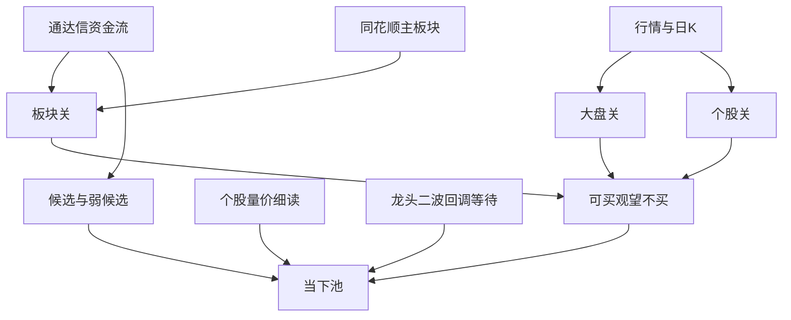

# A股短线买入时机助手 · 产品说明书

规则辅助，不构成收益承诺。不下单，也不使用内幕消息。

---

## 1. 这是什么

本机网页助手，回答一件事：这只 A 股现在能不能为 **2～5 个交易日** 的短线开仓。

- 地址：http://127.0.0.1:8765  
- 结论只有三种：**可买** / **观望** / **不买**  
- 判断写在规则里，不靠模型临场裁决  
- 分发安装见 [`docs/安装与使用.md`](安装与使用.md)（Windows 安装包 / macOS .app·DMG / 便携包）  

适合用来复核「大盘行不行、板块撑不撑得住、个股是不是在追高」，以及把已买票记入**持仓关注**看卖点提醒。不是荐股承诺，也不是自动交易系统。

---

## 2. 怎么用

助手页为**全宽工作台**：顶栏品牌与时钟、大盘条与告警常驻；其下用六个主导航 Tab，一次只展示一个主任务区。

| 主 Tab | 地址 hash | 内容 |
| --- | --- | --- |
| 查这一只 | `/app#decide` | 默认落地：左查询/三道门/下一步/记持仓，右九段摘要可展开 |
| 最近可买 | `/app#signals` | 全宽信号表与回填收益（`/api/signals`） |
| 持仓关注 | `/app#positions` | 全宽持仓表与出场建议 |
| 当下池 | `/app#pool` | 个股分组 pill + 一张表 |
| ETF | `/app#etf` | 主流场内 ETF 白名单：宽基 / 性价比 / 资金活跃 / 全表 |
| 统计 | `/app#stats` | 分层验收文案（次要） |

刷新页面会按 hash 还原 Tab。池子或「最近可买」点名称会先 `judge` 再自动切到「查这一只」；顶部持仓告警的「查看持仓」切到「持仓关注」。非当前 Tab 的内容仍留在页面里，约 15 秒的行情/池子/持仓刷新照常进行。

### 查这一只

1. 输入 6 位代码或名称，点「判断」（或点「刷新结论」）。行情条会自动刷新，**结论不会每 15 秒自动重跑**，避免打断阅读。  
2. 先看印章结论，再看三道门；**不过 / 否决的门会优先靠上显示**（对齐总纲：环境 → 主线 → 个股/资金/买点）。  
3. 主栏标明 **逻辑轨道：短期主线交易**，并附环境分级仓位建议；观望/可买/不买下有「下一步」提示条；**不新增第四种结论**。  
4. 三道门下方有**个股量价细读**，只解释不改结论。  
5. 右侧九段研报默认只显示**旁路摘要**，需要时再「展开九段」；冲突以规则为准，**不得改写可买**。  
6. 若命中「龙头二波」，侧栏提示；**不等于可买**。  
7. 若已实际买入，点「记为持仓」（或池子「记入」），切到**持仓关注**看出场建议；触及建议卖出时顶部会提醒。**提醒 ≠ 下单指令**。  

总纲全文见 [`docs/a-stock-trading-logic.md`](a-stock-trading-logic.md)。

### 最近可买

系统已记入的可买信号与回填的 1/3/5 日收益；点名称可复核三道门。样本不足时勿当胜率承诺。

### 持仓关注 / 卖点提醒

- **记入**：填写或默认现价为成本、买入日、止损比例（默认约 5%）。同一代码重复记入会覆盖开仓记录。  
- **建议**：`持有` / `减仓观望` / `建议卖出`（止损、环境、板块、趋势、时间窗口、冲高回落等规则）。  
- **了结**：点「了结」归档，不再提醒。  
- **刷新**：持仓随页面约 15 秒刷新行情与建议；浏览器若已授权通知，高优先级卖点可弹一条系统通知（未授权不强求）。  
- 接口：`GET/POST /api/positions`，`POST /api/positions/{code}/close`。

### 看当下池

池内 Tab 分三组，并显示数量角标；空态会区分「数据未齐 / 环境弱势 / 本轮无命中」：

| 组 | 列 | 含义 |
| --- | --- | --- |
| 盯盘 | 候选 | 趋势、位置、板块、资金、相对强弱都过了，值得盯；**不等于可买** |
| 盯盘 | 弱候选 | 其余条件过了，只缺个股资金流；不当正式候选 |
| 盯盘 | 只观察 | 趋势还在、板块没坏，但位置还不该买 |
| 可买 | 回踩 / 突破 / 续航 / 主线 | 三道门通过后的四种买点 |
| 模式 | 二波等待 / 二波启动 | 模式池；**不自动等于可买**，启动名单仍须过三道门 |

池子上方有**数据自检**异常句（名单来源、板块对齐、板块日 K 是否落后、资金流有数占比）。也可看 `/api/health`。

### ETF 主流池

独立于个股「当下池」，白名单场内 ETF（约几十只宽基 + 行业/主题），接口 `GET /api/etf/pool`。

| 分组 | 含义 |
| --- | --- |
| 宽基关注 | 沪深300 / 中证500 / 创业板 / 科创等；`rescue_priority` 高者靠前。弱势/防守环境下提示「宽基性价比更值得盯」——**经验标签，不是官方救市监测** |
| 性价比 | 近 60 日回撤够深且贴近/站稳 MA20，近 5 日未暴涨修复；分档文案为「性价比关注」 |
| 资金活跃 | 白名单内成交额靠前，偏短线关注，**不等于可买** |
| 全表 | 白名单一览 |

ETF 分档只用 **性价比关注 / 观望 / 偏贵**，**不套用**个股三道门「可买」。名单与阈值见 `app/config_etf.py`。点名称仍可尝试「查这一只」；个股链路不适配时以本页分档为准。

### 统计

分层验收文案（按买点 / 环境等），样本不足不宣称变好；**不改写可买结论**。

### 时段说明

- **交易中**：信号随快照刷新；行情超过约 90 秒未更新时，页面会提示先别按结论下单。  
- **已收盘**：信号基于收盘数据，下一交易日开盘前再复核。  
- **周末 / 休市**：同样按最近一个交易日收盘数据展示。  

启动方式：

- **Windows 安装包**：开始菜单打开「买入时机」。  
- **macOS**：打开 `买入时机.app` / DMG，或便携包里的 `Start.command`（详见 [`安装与使用.md`](安装与使用.md)）。Mac 通常无通达信，走备用行情主站。  
- **开发源码**（项目目录）：

```text
python -m app
```

或 `python scripts/launcher.py`（数据库：Windows 在 `%LOCALAPPDATA%\买入时机\`，macOS 在 `~/Library/Application Support/买入时机\`）。

---

## 3. 数据从哪来

| 用途 | 主来源 | 说明 |
| --- | --- | --- |
| 指数现价、两市量能 | 通达信 | 读本机通达信 `connect.cfg` 里的行情主站 |
| 成交额靠前名单 | 通达信 | 「沪深 A 股」按成交额排序，补名称与流通市值 |
| 个股 / 指数日 K | 通达信优先 | 失败时再走东财、新浪等 |
| 板块与个股主力净流入 | 通达信 | 近几日主力净流入；缺数时写明「资金流没有 / 暂缺」 |
| 行业 / 概念归属、板块日 K | 同花顺网页 | 选出与个股最相关的主板块 |
| 涨跌家数等全市场统计 | 新浪等快照 | 通达信名单失败时，成交额排名也可回退到快照 |
| 东财 | 偶发备用 | 不与同花顺板块名混在同一关里做决策 |

本机通达信客户端一般**不对外开端口**（例如不监听 `7709`）；工具连的是客户端正在用的那批公网主站。探测本机端口失败时**不硬接 localhost**，继续走主站，不阻塞其余功能。

---

## 4. 业务主流程



单只查询与池子用同一套 `decide` 规则。候选单独筛一遍，**过了候选也不会因此变成可买**。细读与龙头二波也不改三道门结论。

---

## 5. 三道门规则摘要

阈值集中在 `app/config.py`，可按自己的经验改数字，不必先改判断结构。

### 5.1 大盘（总纲 30%）

保留：**进攻 / 震荡 / 高潮 / 防守**，并映射环境三级 **强势 / 震荡 / 弱势**。

- **弱势 / 防守**：不做新开仓 → 不买；建议仓位上限约 3 成。  
- **震荡**：拦追涨突破；偏回踩/续航；建议约 5 成。  
- **强势 / 进攻**：允许主线/突破更积极；建议约 7 成。  
- **高潮**：拦「刚突破」，不拦合格的回踩 / 续航 / 主线。  
- 情绪（涨停/跌停等）与北向：有数才参与；无数则门上标注「宏观资金缺失」，**不假装有数**。  
- stock-sdk 仅作备源，主板块名仍优先同花顺；`/api/health` 标明来源。  

### 5.2 板块（总纲 25%）

1. 用同花顺给股票对齐行业、概念；行业始终可参选，概念须是核心（成交额靠前或龙头标记）。  
2. 在近约 20 个交易日里，选与个股涨跌相关最高的一个作**主板块**；相关太弱的概念会退回行业。  
3. **真主线 / 伪题材**代理：连续+排名前部≈真主线；一日游且额能不连续≈伪题材（伪题材挡突破/主线可买）。  
4. 阶段标签（萌芽/发酵/主升/分歧/尾声）能粗分则展示，否则「阶段未知」留给研报。  
5. 看主板块近 **5 个交易日** 的持续性，而不是只看今天强弱：  

| 状态 | 大致含义 | 对买入 |
| --- | --- | --- |
| 连续 | 近几日多次跑赢或排名靠前 | 可放行（还要过个股） |
| 一日游 | 今天冲到前排，前几日却在后半，且今天吃掉大部分涨幅 | 观望 |
| 走弱 | 排名连续变差且今天已到后半 | 不买 |
| 涨满 | 近几日累计涨幅已满，今天仍在前排 | 观望，等歇一天 |
| 背离 | 近 3 日价格还在涨，板块主力净流入为负 | 观望 |
| 偏弱 | 今天涨幅或排名明显偏弱 | 不买 |
| 样本不足 / 不足 | 日子不够或没有连续强弱 | 观望 |

排名参与否决时，同类板块样本须达到约 **30** 个，避免「只排到 1/1」假象。  
板块日 K 最后一根若早于当前交易日，会重拉，避免和资金流日期对不上。

### 5.3 个股：四种可买与否决

硬否决仍先于买点：大盘防守、跌破向上 MA20、板块走弱/偏弱/一日游/涨满/背离、个股近 3 日价涨资金流出、涨停买不进、近 5 日涨幅六成来自今天、明显高于 5 日线等。

| 买点 | 要点 |
| --- | --- |
| 回踩 | 贴近 MA10（约 ±3%），当日约 -2%～+4%，量未明显放大 |
| 刚突破 | 刚越过近 20 日高点，当日约 2%～6%，量比够；高潮或板块涨满时降为观望 |
| 续航 | MA20 上且向上；价在 MA10 上或离 MA10≤约 4%；当日约 -2%～+4%；量比未明显放大；近 5 日强于上证；近 3 日个股主力净流入合计>0；板块 `连续`。高潮不拦续航 |
| 主线 | 板块 `连续` 且排名前约 40%；成交额前约 20% 或同花顺龙头；近 5 日涨幅约 0～12%；当日约 0～5%；MA20 上；近 3 日个股净流入>0 |

### 5.4 结论怎么出

按顺序否决硬条件，再依次看：回踩 → 突破 → 续航 → 主线。  
**可买来自上述四种买点之一，且硬否决都过。**

---

## 6. 候选、弱候选、细读与龙头二波

### 6.1 考察范围（约 400 只）

从通达信成交额从高到低往下取，凑满约 400 只合格股票：

- 未停牌、非 ST、非北交所  
- 成交额至少约 2 亿元  
- 有流通市值时，约在 20 亿～2000 亿  

页面「日 K 已覆盖 x/400」指这 400 只里均线因子算完的数量；没算完的先不进池。

### 6.2 候选与弱候选

候选五条须同时满足：趋势、位置、板块状态、近 3 日个股资金流合计≥0、近 5 日强于上证且非脉冲日。  

其余都过、**仅缺个股资金流** → **弱候选**，理由写「个股资金流暂缺」，单独一列。

### 6.3 个股量价细读

单只判断附加细读：均线位置、量比与额能、近 5/10 日走势与区间位置、近 3 日主力净流入。**不单独改可买结论。**

### 6.4 龙头二波（仅回调中等待）

页面名称：**我的模式 · 龙头二波（回调等二波）**。本轮**不做**「二波已启动」名单。

入选须同时满足：

1. **一波**：日 K 连续涨停 ≥3（按 10cm/20cm 区分）。  
2. **回调窗口**：最后涨停后已回调 1～5 个交易日。  
3. **非 A 杀**：相对一波高点最大回撤 ≤约 18%；回调期无跌停、无过大单日暴跌。  
4. **仍在等**：现价未破一波高点；尚未出现二波启动形态（如放量阳线约 3%～9% 且量比≥1.3，或已明显站回高点）。  

扫描已覆盖日 K 的约 400 只池。命中只进模式表 / 侧栏提示，**不自动等于三道门可买**。

### 6.5 信号与统计

每次池子或单只给出**可买**时记入本地日志（含回踩 / 突破 / 续航 / 主线），并在后续交易日回填 1 / 3 / 5 日收益。  
核实样本达到约 **8** 笔后，页面才显示胜率；不够时只显示样本不足。  
「最近可买」见 `/api/signals`。

### 6.6 数据自检

`/api/health` 与池子上方展示：名单来源、板块已对齐数、板块日 K 落后交易日数量、抽查资金流有数占比；异常写成可读句子。

---

## 7. 边界与已知限制

- 不覆盖北交所；ST 不进池。  
- 不下单、不接交易通道、不用内幕或付费机构终端数据；不为二波买付费终端。  
- 同花顺概念成分全表的成交额排序常取不到，概念「核心」主要靠龙头标记；行业侧可按成交额看核心。  
- 通达信 / 同花顺网页若限流或协议变动，会出现对齐慢、资金流暂缺、名单回退到新浪等情况；缺数时页面应写明，不拿空数放行。  
- 本机通达信 `7709` 未对外开时只做探测，连不上则继续公网主站。  
- 本工具是规则辅助，不是收益保证。  

---

## 8. 自查：优点、短板、要补的

### 8.1 优点

- 判断是规则，可复现，不把模型当裁判。  
- 三道门拆开说理由，并给出观察价；四种可买（回踩 / 突破 / 续航 / 主线）。  
- 板块看近一段持续性；弱候选与数据自检降低「缺数整票消失 / 悄悄用空数」。  
- 通达信行情、日 K、资金流与成交额名单已接通；同花顺未对齐不进观察池。  
- 个股细读、事后归因列表、龙头二波回调等待模式池已接上。  

### 8.2 短板

- **概念核心偏弱**：全成分金额排序受限，龙头标记覆盖不全。  
- **涨跌家数**仍依赖全市场快照路径，与通达信名单不是同一条链路。  
- **胜率**：样本不足时页面只能提示不够，不能当实盘校验。  
- **运行形态**：当前以本机为主（Windows 安装包 / macOS .app / 源码）；依赖通达信主站（Mac 多为备用主站）与同花顺网页，网络或协议变动会断数据。  
- **二波已启动**名单已分开，但仍不等于三道门可买。  
- 胜率按环境分层统计样本不足时，**不直接改写 verdict**。  

### 8.3 建议补足（优先级）

1. 若通达信本机将来对外开行情端口，优先连本机，减少公网主站抖动。  
2. 概念侧成交额核心覆盖加强。  
3. 可选：TradingAgents 深度研报（需自备 LLM Key；默认关闭）。  
4. **分发后续（未做）**：小团队托管（鉴权与持仓按用户隔离）→ 系统网站变现；小程序不作一期主形态。Win/Mac 安装与打包见 [`安装与使用.md`](安装与使用.md)。  


---

## 9. 权威边界

| 产出 | 权威 |
| --- | --- |
| 可买 / 观望 / 不买 | **仅规则**（三道门） |
| 九段研报 | 旁路参考，冲突时以规则为准 |
| 仓位建议 / 轨道标签 | 输出增强，不改三种结论 |
| 分层胜率 | 验收用，不晋升改裁决 |

---

## 10. 文件对照（给维护用）

| 内容 | 位置 |
| --- | --- |
| 总纲 | `docs/a-stock-trading-logic.md` |
| 安装与打包 | `docs/安装与使用.md` · `scripts/build-installer.ps1` · `scripts/build-installer-mac.sh` · `scripts/launcher.py` |
| ETF 白名单/规则 | `app/config_etf.py` · `app/engine/etf.py` · `app/data/etf.py` · `GET /api/etf/pool` |
| 参数 | `app/config.py`（支持 `HOST`/`PORT`/`TDX_HOME`/`DB_PATH` 环境变量） |
| 三道门汇总 | `app/engine/decide.py` |
| 大盘 / 板块 / 个股 | `app/engine/market.py` · `sector.py` · `stock.py` |
| 续航 / 主线 | `app/engine/decide.py`（`hold` / `leader`） |
| 候选 / 弱候选 / 池子 | `app/engine/pick.py` · `pool.py` |
| 个股细读 | `app/engine/stock_read.py` |
| 龙头二波 | `app/engine/wave2.py` |
| 持仓出场 | `app/engine/exit.py` · `GET/POST /api/positions` |
| 研报九段 | `app/ai/report.py` · `GET /api/report` |
| stock-sdk 备源 | `app/data/stock_sdk_bridge.py` |
| 通达信 | `app/data/tdx.py` |
| 同花顺板块 | `app/data/ths.py` · `boards.py` |
| 页面 | `app/web/index.html` |
| 本地库 | `data/market.db`（已 gitignore） |
